# Alzheimer’s Disease Classification Using CNNs

A PyTorch implementation of **Deep Learning Homework** for the Neural Networks and Deep Learning course at the University of Tehran.

This project explores binary classification of brain MRI images from the Alzheimer’s Disease Neuroimaging Initiative (ADNI), distinguishing between:

- **AD** — Alzheimer’s disease
- **MCI** — Mild cognitive impairment

Three CNN architectures are implemented and compared. The project is an educational coursework exercise, not a clinical diagnostic system.

## Project scope

The repository includes both Python scripts and a notebook. The Python entry point is `main.py`; the notebook is retained as a record of the original coursework workflow and outputs.

## Repository structure

```text

Alzheimers-CNN-Classification/
│
├── figures/
│   └── notebooks/
│       ├── 01_Five_sample_MCI_class.png
│       ├── 02_Five_sample_AD_class.png
│       ├── 03_Augmented_images.png
│       ├── 04_training_proposed_model_plot.png
│       ├── 05_ROC_curve_proposed_model.png
│       ├── 06_confusion_matrix_proposed_model.png
│       ├── 07_training_model_test2_plot.png
│       ├── 08_ROC_curve_model_test2.png
│       ├── 09_confusion_matrix_model_test2.png
│       ├── 10_training_model_test3_plot.png
│       ├── 11_ROC_curve_model_test3.png
│       └── 12_confusion_matrix_model_test3.png
│
├── notebooks/
│   └── Alzheimers_Classification_ADNI2.ipynb
│
├── dataset.py
├── models.py
├── train.py
├── evaluate.py
├── main.py
├── requirements.txt
├── .gitignore
└── README.md

```

The exact contents of `notebooks/` and `results/` depend on the files retained in your local working copy. Generated results should only be committed if they are appropriate to share and do not contain private or identifiable data.

## Dataset

The code expects the dataset root directory to contain one subdirectory per class:

```text
data/
├── AD/
└── MCI/
```

The dataset is **not included** in this repository. ADNI data access is governed by ADNI's data-use and access requirements. Obtain the data through the authorized ADNI process and do not redistribute it through this repository.

### Configure the dataset path

In `main.py`, set `DATA_DIR` to the location of the dataset root directory. For example, when the dataset folder is alongside `main.py`:

```python
DATA_DIR = Path("data")
```

If the data is stored elsewhere (for example, in Google Drive), use the corresponding absolute path.

## Method overview

The workflow implemented for this task includes:

1. Loading image paths and class labels from the AD and MCI folders.
2. Resizing input images to **64 × 64** pixels.
3. Splitting the data into training, validation, and test subsets using stratified sampling.
4. Applying offline augmentation to training images.
5. Training and comparing three CNN architectures.
6. Evaluating the models on the held-out test subset and saving results.

The split should be performed on the original images **before** augmentation. Augmented copies should be created from the training subset only; validation and test images should not be augmented. This avoids placing augmented versions of the same source image in different subsets. Check that the current implementation follows this order when modifying the pipeline.

### Data augmentation

The augmentation operations used in the coursework include:

- Random horizontal flipping
- Shearing
- Translation (shifting)
- Rotation (up to 45 degrees)
- Random resized cropping (zooming)

Four augmented versions are generated per original training image, in addition to the original image, when the offline augmentation routine is configured this way. The exact augmented sample count depends on the training split and the implementation's augmentation settings.


## Dataset Examples and Augmentation

### Sample MRI Images

The following figures show examples of MRI images from the two classes used in this classification task.

**Mild Cognitive Impairment (MCI)**

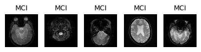

**Alzheimer's Disease (AD)**

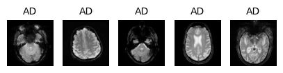

### Data Augmentation

To increase the diversity of the training data, several augmentation techniques were applied to the original training images.

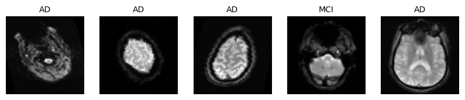


## CNN architectures

The project compares three CNN models:

1. **Proposed Model**
2. **Testing Model 2**
3. **Testing Model 3**

The model definitions are in `models.py`. Refer to that file as the source of truth for the precise layer configuration; the architectures should not be inferred from model names alone.

Glorot/Xavier uniform initialization is used in the coursework model implementation. See `models.py` for the exact initialization applied to each layer.

## Training configuration

The configured experiment described in the coursework uses the following settings. Confirm `main.py` if you change them:

| Parameter | Setting |
|---|---:|
| Input image size | 64 × 64 |
| Optimizer | Adam |
| Loss function | Cross-Entropy Loss |
| Learning rate | 0.0001 |
| Number of epochs | 30 |
| Batch size | 128 |
| Compute device | CUDA GPU when available; otherwise CPU |

The model is trained using PyTorch. `main.py` selects the available compute device and coordinates the experiment.

## Running the project in Google Colab

The project can be run in Google Colab with a GPU runtime. You do not need a local GPU.

### 1. Mount Google Drive

If the project and dataset are stored in Google Drive, mount Drive:

```python
from google.colab import drive
drive.mount("/content/drive")
```

### 2. Change to the project directory

Update the path to match your Google Drive folder:

```python
%cd "/content/drive/MyDrive/-------"
```

### 3. Install dependencies

```python
!pip install -r requirements.txt
```

### 4. Select a GPU runtime

In Colab, select **Runtime → Change runtime type → T4 GPU** (if available). Then check:

```python
import torch

print("CUDA available:", torch.cuda.is_available())
if torch.cuda.is_available():
    print("GPU:", torch.cuda.get_device_name(0))
```

Colab GPU availability and type depend on the account, current resource availability, and session limits. If CUDA is unavailable, the code may run on CPU but training can take considerably longer.

### 5. Configure the data path and run

Make sure `DATA_DIR` in `main.py` points to the dataset root containing the `AD` and `MCI` folders. Then run:

```python
!python -u main.py
```

The script reports its progress in the cell output and saves generated outputs under `results/`, according to the paths configured in the code.

## Results

The Python pipeline saves experiment outputs in the `results/` directory. The exact files and numerical values depend on the run and the current code configuration.

For reproducible reporting, record the run's data split, random seeds, package versions, model settings, and test metrics together. Do not copy numerical results from an earlier notebook run into a results table for a different `main.py` run unless you have confirmed that they came from the same data split and configuration.

## Evaluation

The evaluation code reports classification performance for the held-out test subset. Depending on the current implementation, saved outputs may include accuracy, precision, recall, F1-score, ROC-AUC, confusion matrix, classification report, and loss values.

For binary classification, the label mapping used in the coursework is:

```python
class_to_idx = {
    "AD": 0,
    "MCI": 1
}
```

### Test-set performance comparison

| Metric | Proposed Model | Testing Model 2 | Testing Model 3 |
|:---|:---:|:---:|:---:|
| Test Loss | 0.2185 | 0.2849 | 0.1579 |
| Accuracy | 90.36% | 87.95% | 96.39% |
| Precision (MCI) | 82.93% | 82.05% | 92.11% |
| Recall (MCI) | 97.14% | 91.43% | 100.00% |
| F1-score (MCI) | 89.47% | 86.49% | 95.89% |
| ROC-AUC | 98.57% | 96.25% | 98.57% |

The positive class for precision, recall, and F1-score is MCI (MCI = 1). The test set contains 83 images: 48 AD and 35 MCI.


### Confusion matrices

| Model | Actual AD → Predicted AD | Actual AD → Predicted MCI | Actual MCI → Predicted AD | Actual MCI → Predicted MCI |
|:---|:---:|:---:|:---:|:---:|
| Proposed Model | 41 | 7 | 1 | 34 |
| Testing Model 2 | 41 | 7 | 3 | 32 |
| Testing Model 3 | 45 | 3 | 0 | 35 |

These values use the row order actual AD, actual MCI and column order predicted AD, predicted MCI.


> **Note:** The figures below are from the original Jupyter Notebook
> experiments. The numerical results reported in the model comparison
> table are from the separate `main.py` implementation and may differ.


### Testing Proposed Model (Model 1) 

**Training and Validation Curves**

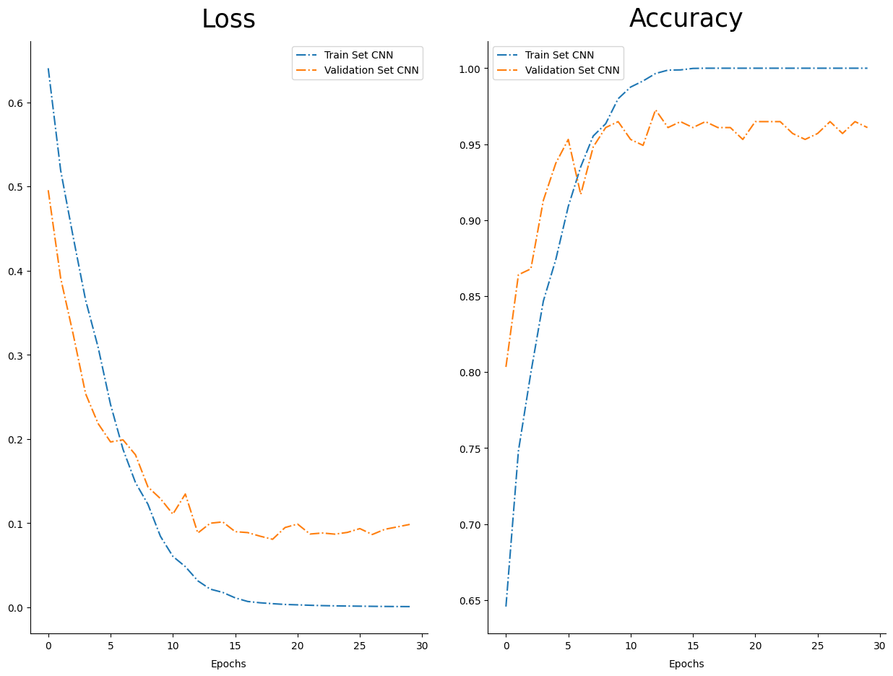

**ROC Curve**

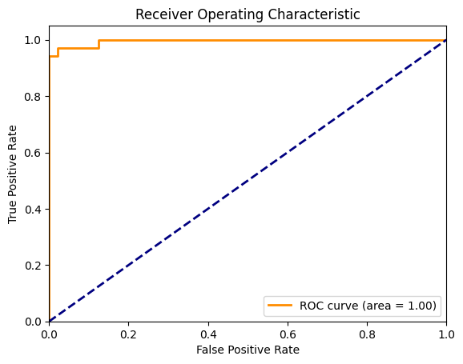

**Confusion Matrix**

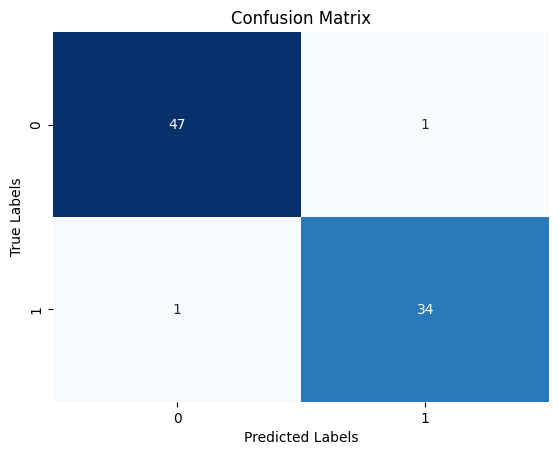

### Testing Model 2

**Training and Validation Curves**

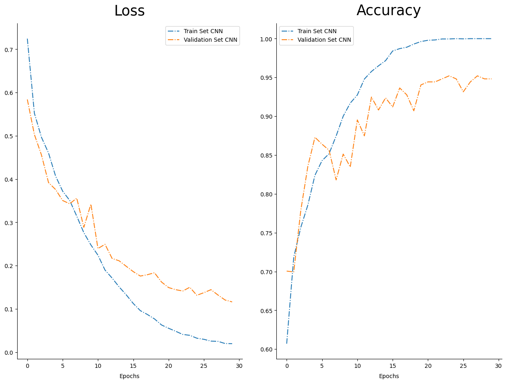

**ROC Curve**

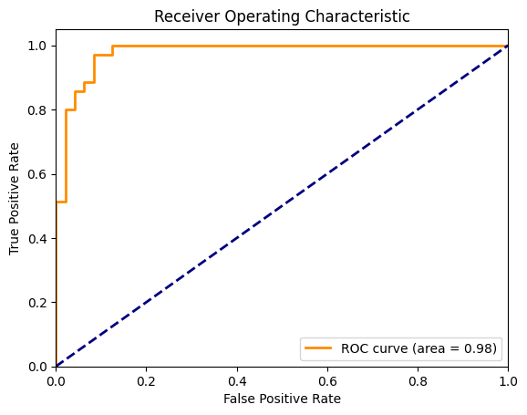

**Confusion Matrix**

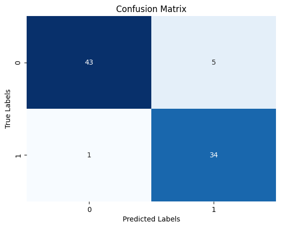


### Testing Model 3

**Training and Validation Curves**

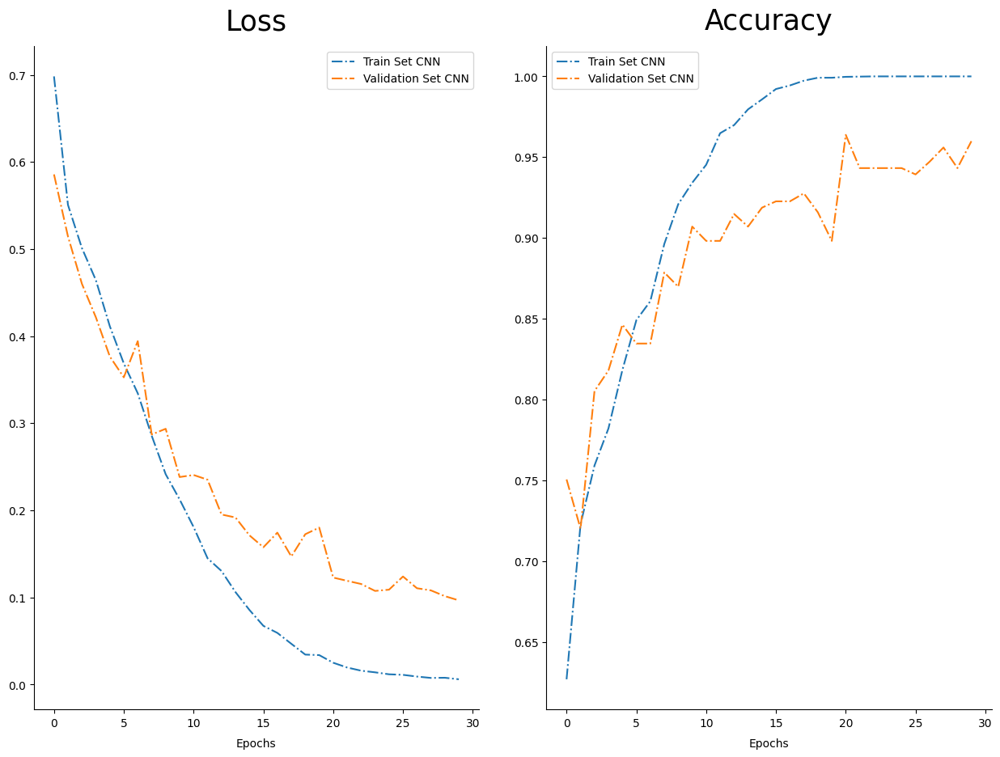

**ROC Curve**

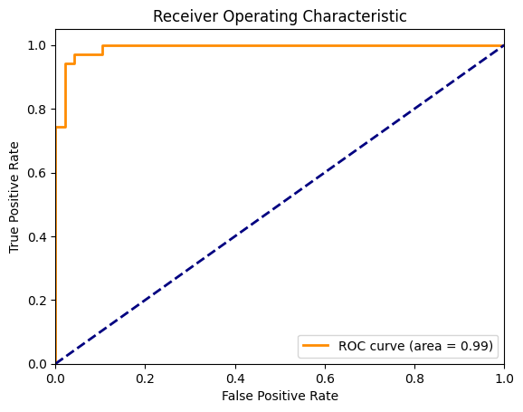

**Confusion Matrix**

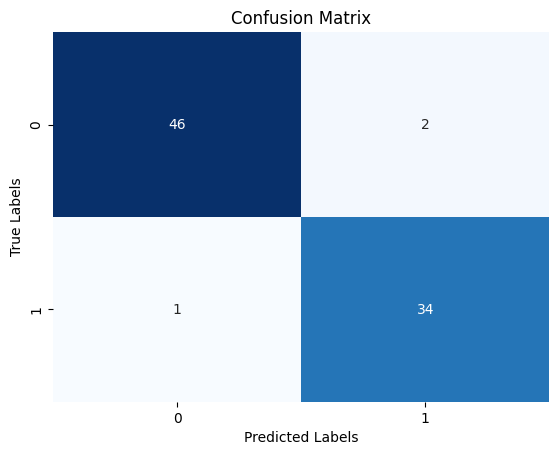


## Limitations and considerations

The results should be interpreted in light of the following limitations:

1. **Image-level versus patient-level separation.** A stratified image-level split preserves class proportions, but it does not guarantee that images from the same participant are confined to one subset. If multiple images from one participant are present, a participant-level split is preferable to reduce the risk of data leakage. Participant identifiers must be available to implement this correctly.
2. **Preprocessing and pixel scaling.** The final tensor values should be checked to ensure that image preprocessing and pixel scaling are consistent across training, validation, and test subsets.
3. **Random augmentation.** Random transformations can produce different augmented samples across runs. For reproducibility, seed Python, NumPy, and PyTorch, and document the split and augmentation settings.
4. **Metric aggregation.** Epoch-level metrics should be calculated using all samples rather than an unweighted average of batch-level metrics, particularly when the final batch contains fewer samples.
5. **Validation labels.** Labels should use the same class-to-index mapping throughout training, validation, and testing. Do not fit a new `LabelEncoder` independently on each batch; use the integer labels already assigned by the dataset.
6. **Small held-out test set.** Performance measured on a small test subset can have substantial uncertainty and may not represent performance on a new cohort.
7. **External generalization.** Evaluation on one dataset and one split does not establish generalization to other hospitals, scanners, acquisition protocols, or independent patient cohorts.
8. **Class and dataset characteristics.** Results may be affected by class imbalance, image selection, preprocessing choices, and possible correlations between images from the same participant.
9. **Coursework scope.** This implementation is not a complete clinical validation study. It does not establish diagnostic utility, clinical safety, or readiness for deployment.
10. **Additional experimental comparisons.** Do not assume that alternative train/test split ratios, dropout experiments, or initialization comparisons have been completed unless the corresponding experiments and results are present in the code and saved outputs.


## Reproducibility and Environment

### Software environment

The project was implemented using Python and PyTorch. The following package versions were installed in the Google Colab environment:

| Package / Component | Version |
|:---|:---|
| Python | 3.13.16 |
| PyTorch | 2.14.1+cu130 |
| Torchvision | 0.29.1+cu130 |
| NumPy | 2.4.6 |
| Pandas | 2.2.3 |
| Matplotlib | 3.10.0 |
| Seaborn | 0.13.2 |
| OpenCV | 5.0.0.93 |
| Pillow | 11.3.0 |
| tqdm | 4.67.3 |
| scikit-learn | 1.6.1 |

**Compute environment:** Google Colab with CUDA-enabled GPU when available. The code also supports CPU execution.

### Computational Environment

- **Platform:** Google Colab
- **GPU:** NVIDIA Tesla T4
- **Python:** 3.13.16
- **PyTorch:** CUDA-enabled build (`2.14.1+cu130`)
- **Device selection:** The implementation automatically uses CUDA when available and falls back to CPU otherwise.


### Reproducibility considerations

- Data splitting is performed on the original images before augmentation.
- Augmentation is applied exclusively to the training subset.
- Validation and test subsets are kept separate from the augmentation process.
- Random seeds and data-splitting settings should be recorded for reproducible experiments.
- Test-set metrics should be reported together with the corresponding model configuration and data split.

## Disclaimer

This project was developed for educational purposes as part of a Neural Networks and Deep Learning course. It is not intended for clinical diagnosis, treatment decisions, or medical decision-making.
